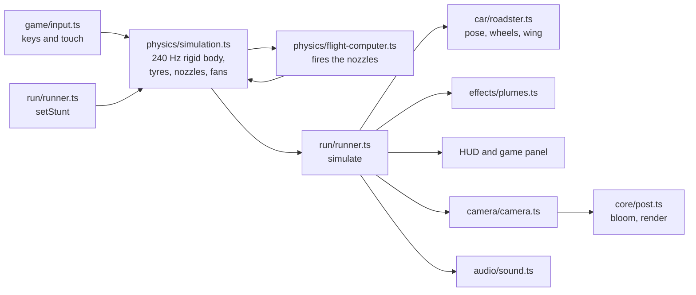

# Contributing

Thanks for helping. This is a fan project: keep it fun, keep it honest about what is real and what is estimated,
and never add Tesla's own photos, videos or logos to the repo.

## Setup

```bash
npm install
npm run dev          # http://localhost:5173 with hot reload
npm test             # run before every pull request (npm run test:watch while you work)
npm run typecheck    # strict TypeScript; npm run build runs it too
```

## How a frame works



`main.ts` runs the loop: `simulate(dt)` steps the physics and copies its state onto the scene, `updateCamera(dt)`
places the camera, `updateSound()` sets the synth levels and `composer.render()` draws.

## Where things live

| Folder | What it does |
| --- | --- |
| `src/physics/` | The simulation. **Pure**: no DOM and no scene objects (three.js only for `Vector3` and `Quaternion`), so the tests run it directly. `simulation.ts` integrates forces and collisions, `flight-computer.ts` decides how hard each nozzle fires (each stunt is a list of phases), `contacts.ts` finds where the wheels touch, `constants.ts` holds every tuning number, `types.ts` the shared types. |
| `src/config.ts` | Constants shared by the physics, the visuals and the tests: car dimensions, the ramp's shape, course size and the track boundaries. |
| `src/car/` | The Roadster model. `geometry.ts` holds the measured cross-sections and lofting, `materials.ts` the materials, `nozzle-layout.ts` where the ten nozzles sit (shared with the physics), `roadster.ts` the assembly and the wing animation. |
| `src/stunts/` | Scenery for the scripted stunts: the parked lineup and the curved ramp. |
| `src/game/` | Playing. `modes.ts` decides who flies (the scripted flight computer or the player) and routes the physics events; `input.ts` is the keyboard and touch controls (one `ACTIONS` table draws the keycaps and touch buttons); `drive-game.ts` is Drive it's rules, with `layout.ts` (random courses, pure, tested) and `course.ts` (the 3D course); `stunt-play.ts` is the played lineup jump and ramp hang; `results.ts`, `records.ts`, `feedback.ts` (toasts, shake) and `ui.ts` are shared. |
| `src/run/` | `sim.ts` creates the app's one simulation; `runner.ts` applies it to the scene and switches stunts. |
| `src/camera/`, `src/audio/`, `src/effects/` | Camera shots, synthesised sound, gas plumes. On-screen banners, flashes and confetti are in `game/celebrate.ts`; `game/milestones.ts` tracks what a run has got past. |
| `src/core/` | Renderer and scene, bloom and resizing, the shared `app` flags, maths helpers. |
| `src/ui/` | Element handles (`byId`, `setLabel`), buttons, full screen, the SVG gauges (`gauges.ts`) and the telemetry cluster (`hud.ts`). |
| `src/styles/` | `tokens.css` (colours and type), `buttons.css`, `stage.css`, `game.css`, `gauges.css`, `app.css` (top bar and layout), `story.css`. |

Shared mutable flags (`playing`, `freeLook`, `visible`, `needsRender`, `snapCamera`) live on the `app` object in
`src/core/state.ts`. Change them through `app.x = …`; don't create module-level `let`s that other modules need to
write.

## Conventions

- **TypeScript, strict.** No `any`; give exported functions explicit parameter types and say in a doc comment what
  they do. Use `import type` for types (the build checks this).
- **Readable names.** Spell things out: `position`, `angularVelocity`, `forwardSpeed`, `maxThrust`, not `pos`, `w`,
  `fwd`, `Tmax`. Short names are fine for a loop index or a coordinate inside a small maths expression
  (`x`, `y`, `z`, `i`).
- **Units are SI**: metres, seconds, newtons, kilograms. In the car's frame, x runs along the car (nose at +x), y is
  up and z is across. Put the unit in a comment when it is not obvious.
- **Physics** steps at a fixed 240 Hz; never make it depend on the frame rate. Numbers that are guesses (mass,
  thrust, grip) belong in `physics/constants.ts` with a comment saying so.
- Match the surrounding style: 2-space indent, double quotes, short comments that explain *why*.
- Colours come from the tokens in `src/styles/tokens.css`.

## Recipes

**Tune the car's handling or thrust.** Edit `src/physics/constants.ts` (or the controller in
`flight-computer.ts`) and run `npm test`. If you change what a stunt does, update the matching checks in
`test/physics.test.ts`.

**Add an obstacle type to Drive it.**
1. Add it to the `CourseItem` union in `src/game/layout.ts`, place it in `generateLayout`, and give it a physics
   shape in `obstacleFor` (a `BoxObstacle` with `breakable: true` if it gives way when hit fast, or a
   `RampObstacle` for a wedge the wheels can drive up).
2. Build its mesh in `buildItem` in `src/game/course.ts`.
3. React to hits in `onDriveHit` / `onDriveBust` in `src/game/drive-game.ts`.
4. `npm test`: the layout tests check every course stays inside the track with room between obstacles.

**Add a control.** Add an entry to `ACTIONS` in `src/game/input.ts` (keys, keycap, caption, icon) and to
`DriverInput`; the keycap and touch button appear by themselves. Then use it in `playerControl` in
`flight-computer.ts`.

**Add a scripted stunt.** Add the scenario to `Scenario` and its phases to `Phase` (`physics/types.ts`), a start
position in `START_X` (`simulation.ts`), and its phases in `flight-computer.ts` (what each nozzle and the drive force
do). Then its scenery under `src/stunts/`, camera shots in `src/camera/camera.ts`, a tab in `index.html`, and
visibility handling in `setStunt` (`src/run/runner.ts`). Add test checks for how it should end.

**Change the car's shape.** Edit the keyframes in `src/car/geometry.ts` (`BODY_KEYFRAMES`) or `CANOPY_KEYFRAMES`
in `roadster.ts` for the glasshouse. Keep wheel positions and sizes in `src/config.ts` so the physics follows.

## Pull requests

- `npm test` passes and `npm run build` succeeds (CI runs both).
- Try the change in the browser: all three tabs, plus a phone-width window.
- Describe what changed and how you checked it; a screenshot or short clip helps for anything visual.
