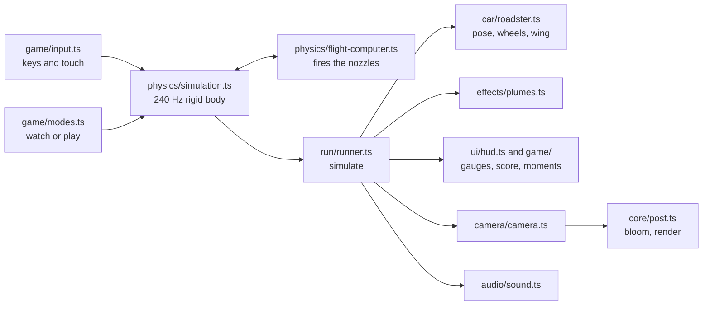

# Contributing to Roadster Liftoff

Thanks for helping. Bug fixes, new obstacles, better physics, sound, art and docs are all welcome. This guide
covers the ground rules, how to get running, how the code fits together, and step-by-step recipes for the most
common changes.

## Ground rules

- **It's a fan project.** Never add Tesla's photos, videos, logos or sound to the repo. Every image here is a
  render of our own model. Facts on the story page need a source in its Coverage list.
- **Be honest about estimates.** Physics numbers that are guesses (mass, thrust, grip) go in
  `src/physics/constants.ts` with a comment saying so.
- **Be kind.** Review the code, not the person. Assume good intent, and ask before assuming.

## Getting started

You need [Node.js](https://nodejs.org) 20 or newer.

```bash
git clone https://github.com/Aashishgtbit/roadster-liftoff.git
cd roadster-liftoff
npm install
npm run dev          # http://localhost:5173 with hot reload
```

| Script | When |
| --- | --- |
| `npm test` | Before every pull request; `npm run test:watch` while you work |
| `npm run typecheck` | Strict TypeScript; `npm run build` runs it too |
| `npm run build` | Before a pull request that touches pages, styles or assets |

## Making a change

1. Open an issue first for anything bigger than a small fix, so we can agree on the approach.
2. Fork the repo, create a branch from `main` (`fix-ramp-camera`, `add-loop-obstacle`), and make the change.
3. Run `npm test` and `npm run build`. Both must pass; CI runs them on every pull request.
4. Try it in the browser: all three tabs, watched and played, plus a phone-width window.
5. Open a pull request that says what changed, why, and how you checked it. A screenshot or a short clip helps for
   anything visual.

Keep pull requests focused: one change per PR is easier to review and to revert.

## How a frame works



`main.ts` runs the loop. `simulate(dt)` reads the controls, steps the physics in fixed 240 Hz substeps and copies
the state onto the scene; `updateCamera(dt)` places the camera; `updateSound()` sets the synth; `composer.render()`
draws. The physics reports what happened (a bust, a hit, a landing) through `sim.events`, and `game/modes.ts`
routes those to the active rules.

## Where things live

| Folder | What it does |
| --- | --- |
| `src/physics/` | The simulation. **Pure**: no DOM and no scene objects (three.js only for `Vector3` and `Quaternion`), so the tests run it directly. `simulation.ts` integrates forces and collisions; `flight-computer.ts` decides how hard each nozzle fires, for the scripted stunts and for the player; `contacts.ts` finds where the wheels touch; `constants.ts` holds every tuning number; `types.ts` the shared types. |
| `src/config.ts` | Constants shared by the physics, the visuals and the tests: car dimensions, the ramp's shape, course size and boundaries. |
| `src/car/` | The Roadster model. `geometry.ts` holds the measured cross-sections and lofting, `materials.ts` the materials, `nozzle-layout.ts` where the ten nozzles sit (shared with the physics), `roadster.ts` the assembly and the wing animation. |
| `src/game/` | Playing. `modes.ts` decides who flies and routes physics events; `input.ts` is the keyboard and touch controls; `drive-game.ts` is Drive it, with `layout.ts` (random courses, pure, tested) and `course.ts` (the 3D course); `stunt-play.ts` is the played stunts; `results.ts`, `celebrate.ts`, `feedback.ts`, `milestones.ts`, `records.ts` and `ui.ts` are shared. |
| `src/run/` | `sim.ts` creates the app's one simulation; `runner.ts` applies it to the scene and switches stunts. |
| `src/stunts/` | The parked lineup (`lineup-layout.ts` holds its sizes for the physics) and the curved ramp. |
| `src/camera/` | Cinematic shots for the demos, and the Auto, Chase and Side views when playing. |
| `src/audio/`, `src/effects/` | Synthesised sound; gas plumes. |
| `src/ui/` | Element handles (`byId`, `setLabel`), buttons and full screen, the SVG gauges (`gauges.ts`) and the telemetry cluster (`hud.ts`). |
| `src/core/` | Renderer and scene, bloom and resizing, the shared `app` flags, maths helpers, poles that hide when they block the camera. |
| `src/styles/` | One CSS file per area. Colours and type come from `tokens.css`; the story page has its own tokens at the top of `story.css`. |
| `src/story/` | The story page's script and its images. |
| `test/` | Vitest: `physics.test.ts` (the stunts and the course physics), `play.test.ts` (the stunts flown with the player's controls), `layout.test.ts` (course fairness). |

## Conventions

- **TypeScript, strict.** No `any`. Give exported functions explicit parameter types and a one-line doc comment.
  Use `import type` for types.
- **Readable names.** Spell things out: `position`, `angularVelocity`, `forwardSpeed`, `maxThrust`, not `pos`,
  `w`, `fwd`, `Tmax`. Short names are fine for a loop index or a coordinate in a small maths expression.
- **SI units**: metres, seconds, newtons, kilograms. In the car's frame, x runs along the car (nose at +x), y is up
  and z is across. Put the unit in a comment when it isn't obvious.
- **Deterministic physics.** The simulation steps at a fixed 240 Hz and must never depend on the frame rate or on
  `Math.random()`. That is what makes the tests meaningful.
- **Shared state** lives on the `app` object in `src/core/state.ts`. Change it through `app.x = …`; don't add
  module-level variables that other modules need to write.
- **Style**: 2-space indent, double quotes, semicolons. Comments explain *why*, not what.
- **CSS**: colours and fonts from the tokens, never literal colours in component rules. Keep keyboard focus
  visible, respect `prefers-reduced-motion`, and check a phone-width window.

## Recipes

### Tune the car's handling or thrust

Edit `src/physics/constants.ts` (or the controller in `flight-computer.ts`) and run `npm test`. If a stunt now ends
differently on purpose, update the matching checks in `test/physics.test.ts` and say why in the PR.

### Add a control

1. Add the input to `DriverInput` in `src/physics/types.ts` and use it in `playerControl` in `flight-computer.ts`.
2. Add an entry to `ACTIONS` in `src/game/input.ts` (keys, keycap, caption, icon) and set it in `applyControls`.
   The keycap in the control dock and the touch button appear by themselves.
3. Add it to the Controls table in the README.

### Add an obstacle to Drive it

1. Add it to the `CourseItem` union in `src/game/layout.ts`, place it in `generateLayout`, and give it a physics
   shape in `obstacleFor`: a `BoxObstacle` (`breakable: true` if it gives way when hit fast) or a `RampObstacle`
   for a wedge the wheels can drive up.
2. Build its mesh in `buildItem` in `src/game/course.ts`.
3. Score it in `onDriveHit` / `onDriveBust` in `src/game/drive-game.ts`.
4. Run `npm test`: the layout tests check that every course stays inside the track with room between obstacles.

### Add a stunt

1. Add the scenario to `Scenario` and its phases to `Phase` (`src/physics/types.ts`), a start position in
   `START_X` (`simulation.ts`), and its phases in `flight-computer.ts`.
2. Build its scenery under `src/stunts/`, add camera shots in `src/camera/camera.ts`, a tab in `index.html`, and
   visibility handling in `setStunt` (`src/run/runner.ts`).
3. To make it playable, add its rules to `src/game/stunt-play.ts`.
4. Add tests for how it should end, both scripted and played.

### Change the car's shape

Edit `BODY_KEYFRAMES` in `src/car/geometry.ts`, or `CANOPY_KEYFRAMES` in `roadster.ts` for the glasshouse. Wheel
positions and sizes live in `src/config.ts`, so the physics follows automatically.

## Reporting bugs and ideas

Open an issue with what you did, what you expected, what happened, and your browser and device. For a physics
bug, the stunt or course number (shown on the scoreboard) and roughly when it happened help a lot.
