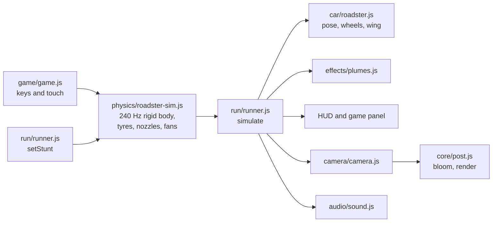

# Contributing

Thanks for helping. This is a fan project: keep it fun, keep it honest about what is real and what is estimated,
and never add Tesla's own photos, videos or logos to the repo.

## Setup

```bash
npm install
npm run dev     # http://localhost:5173 with hot reload
npm test        # run before every pull request
```

## How a frame works



`main.js` runs the loop: `simulate(dt)` steps the physics and copies its state onto the scene, `updateCamera(dt)`
places the camera, `soundUpdate()` sets the synth levels and `composer.render()` draws.

## Where things live

| Folder | What it does |
| --- | --- |
| `src/physics/` | The simulation. **Pure**: no DOM, no three.js scene objects (three.js is passed in for vector maths). Everything that moves the car physically goes here, and the tests run it directly. |
| `src/config.js` | Constants shared by the physics, the visuals and the tests (car dimensions, ramp geometry, course size and the barrier/fence boundaries). |
| `src/car/` | The Roadster model. `geometry.js` holds the measured cross-sections and lofting, `materials.js` the materials, `roadster.js` the assembly, including the nozzle layout the physics uses. |
| `src/stunts/` | Scenery for the scripted stunts: the parked lineup and the curved ramp. |
| `src/game/` | Drive it. `course.js` builds random layouts, barriers and grandstands; `game.js` holds rules, scoring, input and the game HUD. |
| `src/run/runner.js` | The bridge between physics and scene, plus stunt switching. |
| `src/camera/`, `src/audio/`, `src/effects/` | Camera shots, synthesised sound, gas plumes. |
| `src/core/` | Renderer and scene, bloom and resizing, shared `state` flags, maths helpers. |
| `src/ui/` | Element handles, buttons, full screen. |
| `src/styles/` | `tokens.css` (colours and type), `buttons.css`, `stage.css`, `game.css`, `app.css` (top bar and layout), `story.css`. |

Shared mutable flags (`playing`, `free`, `visible`, `dirty`, `snapCam`, `parts`) live on the `state` object in
`src/core/state.js`. Change them through `state.x = …`; don't create new module-level `let`s that other modules
need to write.

## Conventions

- Units are SI: metres, seconds, newtons, kilograms. In the car's frame, x runs along the car (nose at +x), y is
  up and z is across.
- The physics steps at a fixed 240 Hz; never make physics depend on the frame rate.
- Physics numbers that are guesses (mass, thrust, grip) should say so in a comment.
- Match the surrounding style: 2-space indent, double quotes, short comments that explain *why*.
- Colours come from the tokens in `src/styles/tokens.css`.

## Recipes

**Tune the car's handling or thrust.** Edit `src/physics/roadster-sim.js` (drive force, steering, jets) and run
`npm test`. If you change what a stunt does, update the matching checks in `test/physics.test.mjs`.

**Add an obstacle type to Drive it.** In `src/game/course.js`, add a branch to `buildCourse` that creates the
mesh and pushes a box `{ id, kind, g, x0, x1, y0, y1, z0, z1 }` into `game.boxes`. Set `bust: true` if it breaks
when hit fast, or `ramp: true` (with `h`) for a wedge the wheels can drive up. React to hits in `gameHit` /
`gameBust` in `src/game/game.js`. Then run a few random courses to check every layout can still be finished.

**Add a scripted stunt.** Add a scenario to the `control()` switch in the physics (its phases and how each
nozzle fires), its scenery under `src/stunts/`, camera shots in `src/camera/camera.js`, a tab in `index.html`,
and visibility handling in `setStunt` (`src/run/runner.js`). Add test checks for how it should end.

**Change the car's shape.** Edit the keyframes in `src/car/geometry.js` (`KF` for the body, `CK` in
`roadster.js` for the glasshouse). Keep wheel positions and sizes in `src/config.js` so the physics follows.

## Pull requests

- `npm test` passes and `npm run build` succeeds (CI runs both).
- Try the change in the browser: all three tabs, plus a phone-width window.
- Describe what changed and how you checked it; a screenshot or short clip helps for anything visual.
