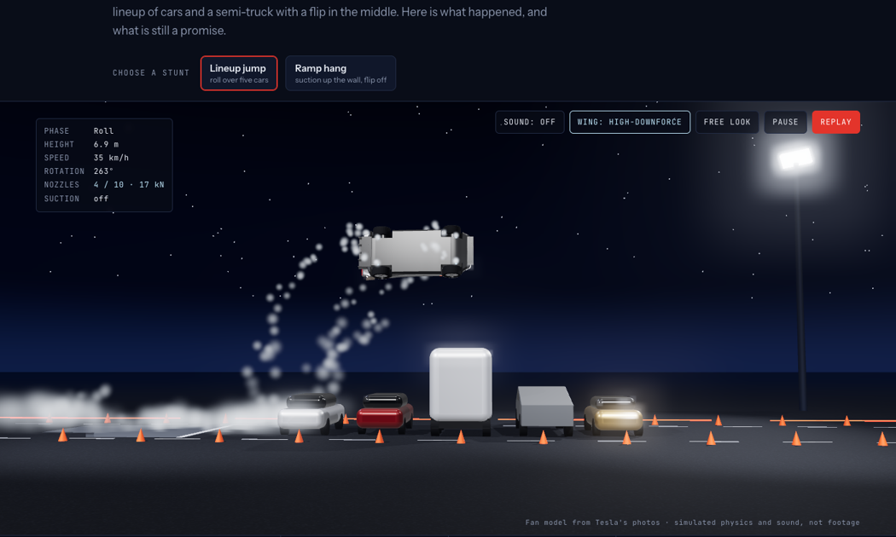
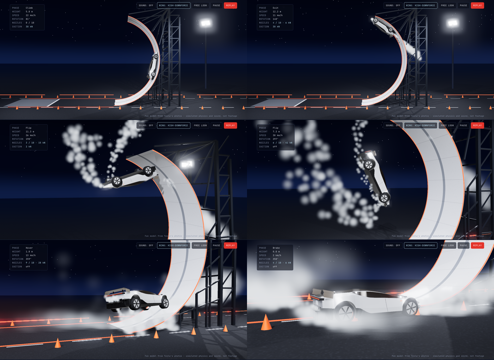
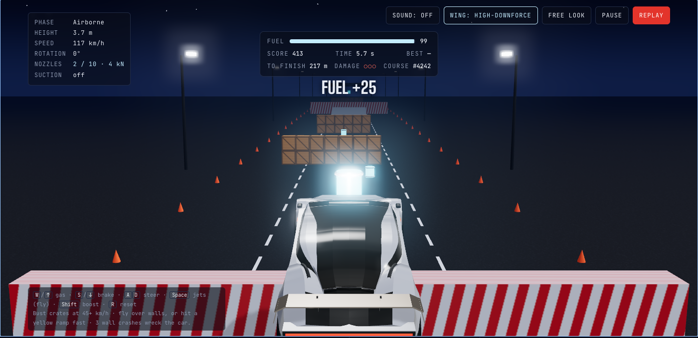

# Roadster Liftoff

An unofficial fan page about the Tesla Roadster unveiling on October 15, 2026, built around two
real-time 3D stunts that are **computed by a physics simulation**, with sound generated live from the same numbers.



> **Fan project.** Not affiliated with or endorsed by Tesla or SpaceX. The car is a fan-made model built from
> Tesla's public launch photos and videos, not official design data, and no Tesla images are included in this repo.
> Masses, thrusts and other physics values are estimates. Tesla, Roadster, Cybertruck, Cybercab and Semi are
> trademarks of Tesla, Inc.

## Two stunts and a game

**Lineup jump.** The car spools its floor jets, lifts off, rolls 360° along its direction of travel over two
sedans, a Semi cab, a Cybertruck and a Cybercab, and glides down to land at about 2 m/s.

**Ramp hang.** Suction fans pull the car onto a tall curved wall. It climbs past vertical, pauses upside down
about 12 m up, creeps to the end of the runway and tips off upside down. Past the runway it rolls 180° about
its own length (an x-axis flip), so it comes up on its wheels facing the opposite way to the runway, hovers slowly
down on its jets, settles at the foot of the ramp and drives away.



**Drive it.** Your turn. Every run gets a new random 330 m night course (or retry the same one), boxed in by
concrete barriers you can scrape along, with grandstands beyond:

- **Crate stacks**: bust through at 45 km/h or more, or fly over.
- **Striped walls**: fly over them on the jets, or hit a **yellow kicker ramp** fast and launch over with no fuel.
  Hit a wall above 35 km/h and it is a crash; three crashes wreck the car.
- **Fuel canisters**: the jets burn fuel; canisters refill it (some only reachable in the air), and the tanks
  recompress slowly on the ground.
- **Clock and record**: a live timer, with your best time and score kept in your browser.

Score is distance plus 100 per crate stack, 25 per canister, minus 200 per crash, plus a time bonus at the finish.



## Run it

Built with [Vite](https://vite.dev) and [three.js](https://threejs.org). You need Node 18 or newer.

```bash
npm install
npm run dev        # local dev server with hot reload
npm test           # headless physics checks for every stunt and the game
npm run build      # static site in dist/
npm run preview    # serve the built site
```

There are two pages: `index.html` is the full-window app (stunt tabs, story link, sound and **full screen**, or
press `F`), and `about.html` is the story (the unveiling, the demo beats, the trims, a 0–60 drag strip, the
timeline, what is still unproven, how the simulation works, and sources).

## Project layout

```
index.html, about.html     page markup; each loads one entry module
src/
  main.js                  app entry: styles, module start-up order, first frame, render loop
  config.js                shared constants: car dimensions, ramp geometry
  physics/roadster-sim.js  the simulation (pure, no DOM; the tests import it directly)
  car/                     the Roadster model: geometry, materials, assembly
  scene/                   sky, ground, markings, floodlights
  stunts/                  the lineup and the ramp
  game/                    Drive it: course generation and game rules
  run/runner.js            steps the physics and applies it to the scene and HUD
  camera/, audio/, effects/, core/, ui/
  styles/                  tokens, buttons, stage, game, app, story
  story/                   the story page's script
test/physics.test.mjs      headless checks
```

See [CONTRIBUTING.md](CONTRIBUTING.md) for how the pieces fit together and how to add a stunt or an obstacle.

Driving (Drive it):

| Key | Touch | Does |
| --- | --- | --- |
| `W` / `↑` | Gas | Accelerate |
| `S` / `↓` | Brake | Brake, then reverse |
| `A` `D` / `←` `→` | ◀ ▶ | Steer (front wheels on the ground, nose jets in the air) |
| `Space` | Jets | Floor jets: climb to a hover about 4.5 m up and hold it |
| `Shift` | Boost | Rear jets |
| `R` | | Put the car back on its wheels (it also rights itself if stuck upside down) |

Controls in the 3D view:

| Control | What it does |
| --- | --- |
| **Choose a stunt** | Switch between Lineup jump, Drive it and Ramp hang |
| **Sound** | Turn the live sound on or off (browsers only allow audio after a click) |
| **Wing** | Cycle Tesla's Track Mode aero: Road (stowed), High-Downforce, Low-Drag |
| **Free look** | Drag to orbit the car; click again to return to the cinematic camera |
| **Pause / Replay** | Pause the run or restart it |

## How the simulation works

Everything runs at a fixed 240 Hz in the browser:

- **Rigid body.** A 1,900 kg car with separate roll, pitch and yaw inertia.
- **Suspension and tyres.** Each wheel casts a ray to the ground or the curved ramp and rides its own spring and
  damper. Tyre grip stays inside a friction circle (μ 1.15).
- **Ten cold-gas nozzles.** Four under the floor near the wheel arches, four in the diffuser, two in the nose,
  each pushing from its real position with about 40 ms of valve lag, so uneven firing turns the car.
- **Suction fans.** Up to 1.6 times the car's weight, pulling the floor toward the surface the wheels are on.
- **Aero.** Drag, plus downforce that depends on the wing mode.
- **Player control (Drive it).** Throttle and brake through the tyres, front-wheel steering with less lock at speed,
  jets that hold the car level with a quaternion attitude controller and a height hold, and solid obstacle boxes:
  the hull collides with them, wheels can land on top of them and drive up kicker ramps, crates give way above
  12.5 m/s, and a solid hit is an impact (the speed into the obstacle goes at once) so nothing can tunnel through a
  wall. An in-air stability assist keeps the car level after a ramp launch.
- **Flight computer.** The car was remote-operated on the night; here a controller flies each stunt phase by phase:
  roll profiles, a quaternion attitude hold, heading hold with the nose jets, sideways drift cancelling, a landing glide path and a
  hover descent.

The sound is synthesised with the Web Audio API from the simulation state: motor whine from wheel speed, tyre
roar, jet hiss and roar from total thrust, a pop as each valve opens, fan whine from suction, and a landing thump
scaled by the touchdown speed. Volume and stereo pan follow the camera.

## Tests

`npm test` imports `src/physics/roadster-sim.js` directly and runs every stunt and the game physics headlessly,
checking the outcomes: lineup clearance, apex, a full roll, landing speeds, drift, hang height, the ramp stunt's
x-axis flip and landing heading, crate busting, flying over walls, kicker-ramp launches and that a fast wall hit
cannot tunnel through.

## Publish with GitHub Pages

The workflow in `.github/workflows/deploy.yml` tests and builds every push and pull request, and deploys `main`.
One-time setup: in the repository settings, open **Pages** and set **Source** to **GitHub Actions**.

## Sources

- [CNN: Tesla unveils what it says is a flying car](https://edition.cnn.com/2026/10/15/business/tesla-unveils-what-it-says-is-a-flying-car)
- [Electrek: Tesla unveils Cyberfied new Roadster that can kickflip](https://electrek.co/2026/10/15/tesla-unveils-cyberfied-new-roadster-kickflip/)
- [Electrek: Roadster event after nearly 9 years of delays](https://electrek.co/2026/10/13/tesla-roadster-event-thursday-nine-years-delays/)
- [Dezeen: Tesla launches flying Roadster concept car](https://www.dezeen.com/2026/10/16/tesla-launches-flying-roadster-concept-car/)
- [Fox Business: New Roadster takes flight at SpaceX facility](https://www.foxbusiness.com/technology/teslas-new-roadster-makes-flying-debut-hitting-60-mph-under-second)
- Tesla's launch posts on X: [the ramp](https://x.com/Tesla/status/2110913438293647789), [Track Mode](https://x.com/Tesla/status/2110905133785829671), and [Elon Musk's lineup jump](https://x.com/elonmusk/status/2110913107094606330)
