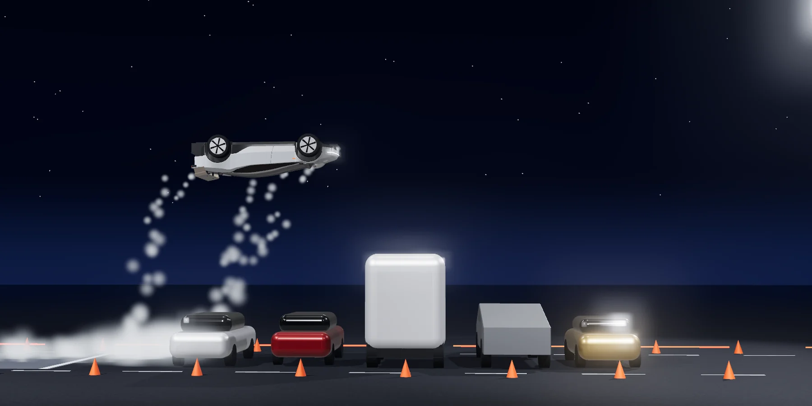
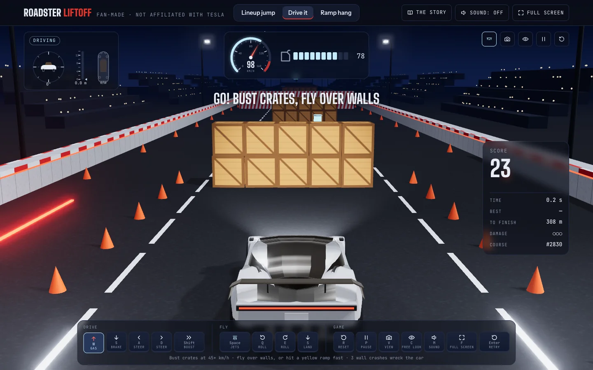
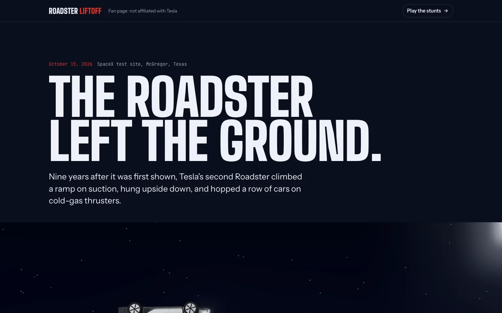

# Roadster Liftoff

A fan-made, physics-simulated 3D take on the Tesla Roadster unveiling of October 15, 2026. Watch the ramp hang
and the lineup jump the way they happened on the night, fly them yourself, or race a random night course. Every
move is computed by a rigid-body simulation running in your browser, and the sound is synthesised live from the
same numbers.

[](https://github.com/Aashishgtbit/roadster-liftoff/actions/workflows/deploy.yml)

**[Play it in your browser →](https://aashishgtbit.github.io/roadster-liftoff/)**



> **Fan project.** Not affiliated with or endorsed by Tesla or SpaceX. The car is a fan-made model built from
> Tesla's public launch photos and videos, not official design data, and the repo contains no Tesla images or
> logos. Masses, thrusts and other physics values are estimates. Tesla, Roadster, Cybertruck, Cybercab and Semi
> are trademarks of Tesla, Inc.

## What's in it

| | Watch | Play |
| --- | --- | --- |
| **Lineup jump** | The car spools its floor jets, lifts off, rolls 360° over two sedans, a Semi cab, a Cybertruck and a Cybercab, and glides down to land at about 2 m/s. | Lift off before the first car, roll in the air, and land on your wheels past the last one. The parked vehicles are solid. |
| **Ramp hang** | Suction fans hold the car on a curved wall past vertical. It pauses upside down 12 m up, tips off the end, rolls 180° about its length and lands facing back. | Climb the wall, let go of the gas to hang upside down, drive off the end, flip, and land on your wheels. |
| **Drive it** | | A new random 330 m course every run: bust crate stacks at 45 km/h or more, fly over walls on the jets or launch off kicker ramps, collect fuel, flip for points. Three wall crashes wreck the car. |

While you play, a speedometer, fuel gauge, altimeter, attitude dial and a map of the ten nozzles show what the car
is doing; a scoreboard tracks points as you earn them; banners, screen flashes and confetti mark each success or
crash; and the camera looks ahead along your path. Best scores are kept in your browser.



The second page, `about.html`, is the story of the night: what the car did, the spec sheet as announced, a 0–60
drag strip at real speed, the trims, what is still unproven, the timeline, and the coverage.



## Controls

| Key | Touch | What it does |
| --- | --- | --- |
| `W` `↑` | ↑ | Gas (up the wall on the ramp) |
| `S` `↓` | ↓ | Brake, then reverse. In the air: glide down to a soft landing on the jets |
| `A` `D` `←` `→` | ‹ › | Steer: front wheels on the ground, nose jets in the air |
| `Space` | jets | Floor jets: climb to a hover and hold it |
| `Q` `E` | ⟲ ⟳ | Roll in the air. Let go past halfway and the car finishes the flip |
| `Shift` | boost | Rear jets |
| `R` | | Put the car back on its wheels |
| `V` | | Camera view: Auto, Chase or Side |
| `C` | | Free look: drag to orbit the car |
| `P` · `M` · `F` | | Pause · sound · full screen |
| `Enter` · `Esc` | | Start the run again · close the results card |

On screen, **Play it / Watch demo** switches a stunt between flying it yourself and watching the flight computer,
and **Wing** cycles the Track Mode aero (Road, High-Downforce, Low-Drag), which changes the downforce.

## Run it locally

You need [Node.js](https://nodejs.org) 20 or newer.

```bash
git clone https://github.com/Aashishgtbit/roadster-liftoff.git
cd roadster-liftoff
npm install
npm run dev
```

Then open the address Vite prints (usually http://localhost:5173).

| Script | Does |
| --- | --- |
| `npm run dev` | Dev server with hot reload |
| `npm test` | Headless checks of every stunt, the game physics and the course generator (Vitest) |
| `npm run typecheck` | Strict TypeScript over the app, the tests and the config |
| `npm run build` | Type-check, then build the static site into `dist/` |
| `npm run preview` | Serve the built site |

## How it works

The simulation steps at a fixed 240 Hz, independent of the frame rate:

- **Rigid body.** A 1,900 kg car with its own inertia for roll, pitch and yaw, integrated with semi-implicit
  Euler and Euler's equations for the spin.
- **Suspension and tyres.** Each wheel casts a ray to the ground, a box top, a kicker ramp or the curved wall, and
  rides its own spring, damper and bump stop. Tyre forces stay inside a friction circle (μ 1.15).
- **Ten cold-gas nozzles.** Four under the floor, four in the diffuser, two in the nose. Each pushes from its own
  position with about 40 ms of valve lag, so firing one side harder turns the car.
- **Suction fans** pull the floor toward the wall with up to 1.6 times the car's weight.
- **Aero.** Drag, plus downforce that depends on the wing mode.
- **Collisions.** Hull points push out of the ground, the ramp and obstacles; a solid hit removes the speed into
  the obstacle at once, so nothing tunnels through a wall.
- **Flight computer.** The demos are scripted as phases (spool, lift, roll, glide, touchdown…) using roll
  profiles, a quaternion attitude controller, heading hold and a glide-path landing. When you play, the same
  thrusters take your controls, with a hover height hold and a stability assist.

Sound is Web Audio, generated from the simulation state: motor whine from wheel speed, tyre roar, jet hiss and
roar from total thrust, a pop as each valve opens, fan whine, and a landing thump scaled by the touchdown speed.

## Project structure

```
index.html            the game: full-window 3D stage
about.html            the story page
src/
  main.ts             app entry: loads the scene, warms up the first frame, runs the render loop
  config.ts           shared constants: car dimensions, ramp shape, course size and boundaries
  physics/            the simulation; pure TypeScript, no DOM, so the tests run it directly
  car/                the Roadster model: measured cross-sections, materials, nozzle layout
  game/               playing: modes, input, Drive it, the stunt challenges, scoring, results
  run/                the app's simulation instance and the runner that applies it to the scene
  scene/, stunts/     the night, the lights, the parked lineup and the ramp
  camera/, audio/     cinematic shots, play cameras, synthesised sound
  effects/, ui/       gas plumes, SVG gauges, the telemetry cluster, buttons
  styles/             CSS, one file per area
  story/              the story page's script and images
test/                 Vitest: the stunts, the played stunts, the course layouts
```

[CONTRIBUTING.md](CONTRIBUTING.md) explains how the pieces fit together, the conventions, and step-by-step
recipes for tuning the car, adding a control, an obstacle or a stunt.

## Tests

`npm test` runs the real physics with the car's real nozzle layout, headlessly. It checks that the lineup jump
clears every vehicle with a full roll and a soft landing, that the ramp hang hangs, flips about the car's length
and lands facing back, that crates bust only at speed, that the jets clear walls, that a flat-out wall hit cannot
tunnel through, and that the track boundaries hold. An autopilot that presses the player's keys proves both
stunts and a flip can be done with the controls, and every random course layout is checked for fairness.

## Deploying

Every push and pull request runs the type-check, the tests and the build
([`.github/workflows/deploy.yml`](.github/workflows/deploy.yml)). Pushes to `main` deploy to GitHub Pages. To turn
that on once: repository **Settings → Pages → Source: GitHub Actions**.

## Sources

- [CNN: Tesla unveils what it says is a flying car](https://edition.cnn.com/2026/10/15/business/tesla-unveils-what-it-says-is-a-flying-car)
- [Electrek: Tesla unveils Cyberfied new Roadster that can kickflip](https://electrek.co/2026/10/15/tesla-unveils-cyberfied-new-roadster-kickflip/)
- [Electrek: Roadster event after nearly 9 years of delays](https://electrek.co/2026/10/13/tesla-roadster-event-thursday-nine-years-delays/)
- [Dezeen: Tesla launches flying Roadster concept car](https://www.dezeen.com/2026/10/16/tesla-launches-flying-roadster-concept-car/)
- [Fox Business: New Roadster takes flight at SpaceX facility](https://www.foxbusiness.com/technology/teslas-new-roadster-makes-flying-debut-hitting-60-mph-under-second)
- Tesla's launch posts on X: [the ramp](https://x.com/Tesla/status/2110913438293647789), [Track Mode](https://x.com/Tesla/status/2110905133785829671), and [Elon Musk's lineup jump](https://x.com/elonmusk/status/2110913107094606330)

Built with [three.js](https://threejs.org), [Vite](https://vite.dev), [TypeScript](https://www.typescriptlang.org)
and [Vitest](https://vitest.dev).
